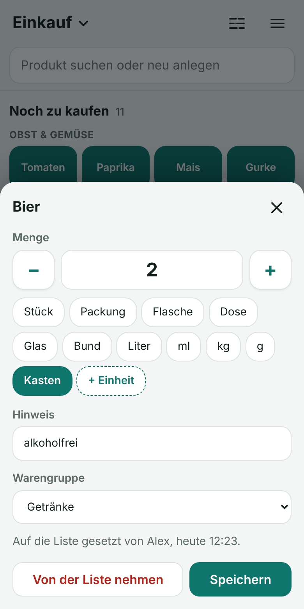
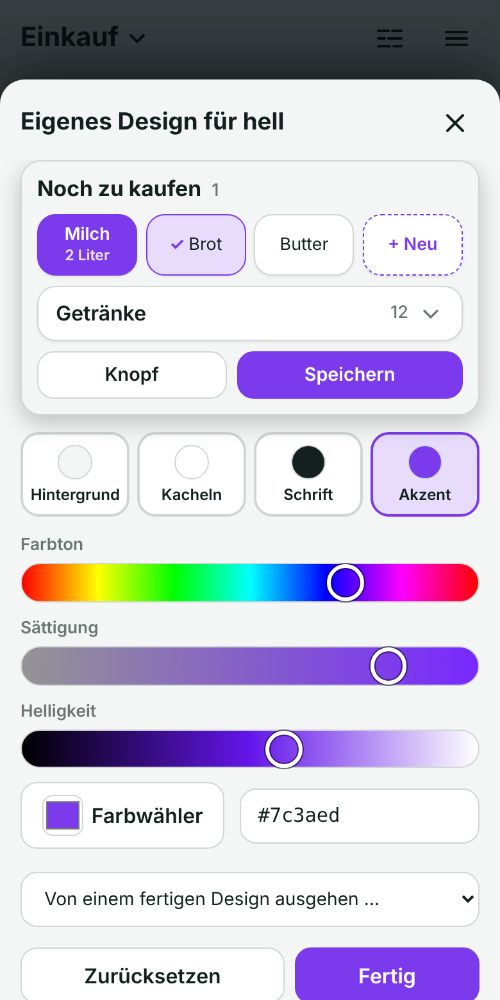

# Kaufen

[Deutsch](README.md) · **English**

[](#requirements)
[](#license)
[](https://ko-fi.com/burnersen)

**[⬇️ Download the latest release](../../releases/latest)** · **[☕ Buy me a coffee](https://ko-fi.com/burnersen)**

Shared shopping lists you host yourself, written in **plain PHP** and installed with a single file. No dependencies, no build step, no MySQL, no requests to third-party servers. Runs on basic web hosting.

*Kaufen* is German for "to buy". You tap products from a ready-made catalog, sorted by category. In the store you tap them again and they are gone, for everyone who shares the list.

Upload `kaufen-install.php`, open it in the browser, create the first account. That is the whole installation.


<p>
  
  
  
</p>

*Quantity picker, settings with language and themes, color mixer for your own theme. The screenshots show the German interface with made-up sample data. Everything you see there is available in English too.*

> 💜 **Using Kaufen and happy with it?** A ⭐ on GitHub is the easiest way to let me know, and it does more than you'd think: stars are the visible proof that a project does good work, and they are how small projects like this one get found by other people in the first place. Or [tell me what you use it for](https://github.com/burnersen/kaufen/issues/new), I read every message. Thanks for being here!

## Features

- **German and English:** each account picks its language in the settings. A German device starts in German, all others in English. Everything is translated, including the catalog. In a shared list one person sees "Milch" and the other sees "Milk", and it is still the same entry.
- **Catalog** with about 810 products in 16 categories, in the order of a typical supermarket. Text only, no images.
- **Tap** to put a product on the list, tap it in the list to check it off. For a few seconds afterwards you can undo.
- **Sync across all devices:** your own changes go to the server right away. Only while Kaufen is open and visible and nothing is going on does the device ask every few seconds whether something has changed. The administrator can set the interval (1 to 60 seconds, default 5).
- **Search** across the whole catalog, in both languages: "milch" finds Milk as well. If a product does not exist, you create it right from the search and assign it to a category.
- **Quantity or note:** long-press (on a computer: right-click). The counter starts at 1 with no unit. Adjust it with plus and minus, tap a unit if you want one (piece, pack, liter, kg …) and add a note. A plain 1 is not shown on the tile.
- **Custom units:** each account can add its own, such as "crate", "bag" or "roll", right in the quantity picker or in the settings.
- **Remembers quantities:** when you check a product off, Kaufen remembers what was on it. Bought five colas, and next time it says "5" again, visible on the tile, and one tap puts it on the list the same way. Each account can turn this off in the settings, then it always starts at 1. "Reset quantity" forgets the remembered quantity of a product.
- **Recently bought:** the latest and most frequent products, collapsible like the categories.
- **Ten themes and your own colors:** five light and five dark color schemes, plus one custom theme each from the color mixer (sliders or color picker, with preview). With "Same as device" Kaufen switches automatically between your light and your dark favorite. The look belongs to the account and applies on all devices.
- **Multiple lists:** everyone can create lists and share them with any accounts.
- **Notifications on your phone:** if you like, you get a notification when someone puts something on a shared list. Each account turns this on or off per device in the settings. Bundled instead of one by one: three products make one notification, sent the moment the other person leaves Kaufen. Checking things off in the store does not notify anyone.
- **Share a list as text:** the open list goes to your messenger, mail and so on as plain text, or to the clipboard, for people without an account.
- **Store layout:** the categories can be ordered per list to match the way your own store is laid out.
- **Templates:** "BBQ" or "Breakfast" puts several products on the list with one tap. The current list can be saved as a template too.
- **Keep shopping without a signal:** the app starts without reception, changes are collected and sent later.
- **Who added it:** in shared lists the product shows who put it there.
- **Screen stays on** while the app is open (can be turned off).
- **Manage the catalog:** create, rename, move and delete products and categories. The administrator can delete everything and restore the default. A backup is made automatically before every major change, the last 10 versions can be restored.
- **Accounts:** the first account is the administrator, who creates the others. There is no open sign-up.
- **Three views:** small tiles, compact or shopping mode (large rows for ticking off in the store), switched with the button at the top right, remembered per device.
- Installable as an app (PWA), light and dark mode, throttling against password guessing.

## Requirements

- PHP 7.4 or newer (8.x recommended) with the `pdo_sqlite` extension
- For notifications on your phone in addition: the `openssl` extension, plus `curl` or `allow_url_fopen`, and the web host must allow outgoing connections. If any of that is missing, Kaufen works as usual, just without notifications.
- A web server with PHP (Apache works out of the box)
- **HTTPS.** Without HTTPS the password travels in plain text, and the app cannot be installed on a phone.

## Installation

1. Download `kaufen-install.php` from the [latest release](../../releases/latest) and copy it to a directory on your web server.
2. PHP must be allowed to write to that directory (it creates `index.php`, the folder `app/` and later `data/` there).
3. Open `kaufen-install.php` in the browser **right away** and click "Install now". The file unpacks the program, deletes itself and redirects. Create the first account there. This account is the administrator.
4. Check that `data/` cannot be reached from outside: `https://your-address/data/config.php` must show "403 Forbidden".
5. In the menu under *Accounts* create the other accounts and invite them to the shared list in the same step.

> Whoever opens a freshly uploaded Kaufen that has not been set up yet becomes the administrator. So do step 3 immediately after uploading.

**Rather do it by hand?** The release also contains `kaufen-<version>.zip`. Unpack it and upload the contents of the folder `kaufen/`, that is `index.php` **and** the folder `app/`.

### On your phone

Open the address in the browser, sign in, then choose "Add to Home screen" in the browser menu (iPhone: Share → "Add to Home Screen"). From then on Kaufen starts like an app.

## Updating

Upload the new `kaufen-install.php` and open it. Only the program files are replaced, the folder `data/` is left untouched.

Make a backup first. This is how to back up and how to go back (in the Kaufen directory, via SSH):

```sh
# Create a backup
cp -a data "data-backup-$(date +%Y%m%d-%H%M)"

# Restore (insert the name of your backup)
mv data data-broken && cp -a data-backup-YYYYMMDD-HHMM data
```

Without SSH: download the folder `data/` via FTP and upload it again to restore.

## Structure

```
index.php      entry point and settings
app/lib/       language, database, accounts and sign-in, lists and catalog, default catalog, notifications
app/routes/    all JSON actions
app/views/     sign-in page and main page
app/assets/    CSS, JavaScript, English translation, icons, service worker
data/          created on first start, holds the database and accounts
tools/         builds the release files (php tools/build-release.php)
```

The files in `app/` do nothing when called directly, everything goes through `index.php`. Under Apache an `.htaccess` blocks the folder as well. The default catalog lives in `app/lib/catalog.php` and can be adjusted there. The English texts and product names are in `app/assets/i18n.js`, the English server messages in `app/lib/lang.php`. Comments in the source code are in German.

## Good to know

- **Notifications:** on the iPhone they only work when Kaufen is installed via "Add to Home Screen" (iOS 16.4 or later), on Android and on a computer they also work in the browser. When you turn them on, the server sends a test, so you see right away whether it can reach the notification service. Notifications go straight from your own server to the browser's notification service (Apple, Google, Mozilla, Microsoft), encrypted for the individual device, with no other service in between. If a device does not say goodbye when leaving (no signal), the notification goes out about three minutes after the last change, as soon as any device has Kaufen open again.

- The built-in catalog is stored in German in the database and is only translated for display on English accounts. Products, categories and templates you create yourself stay exactly as typed.
- Remembered quantities belong to the list and apply to everyone sharing it. Language, "remember quantity", custom units and the look belong to the account.
- The catalog and the templates apply to all accounts and all lists. Any account may change individual products and categories. "Delete everything", "Restore default" and the backups are reserved for the administrator.
- Lists are only visible to their members. Only the person who created a list can share, rename and delete it.
- Passwords are stored only as a hash (`password_hash`). The shopping lists themselves are not encrypted, anyone with access to the web space can read them.
- A device stays signed in for 180 days as long as it is used. Changing your password signs out all other devices.

## ☕ Support

Kaufen is free and made in my spare time, on my own hardware and electricity bill. If it saved you time and you'd like to say thanks, you can [drop a little something in the tip jar on Ko-fi](https://ko-fi.com/burnersen), it keeps motivation and coffee flowing. ☕ Completely optional, and either way: thank you for using it!

## License

GNU Affero General Public License v3.0, see [LICENSE](LICENSE).
