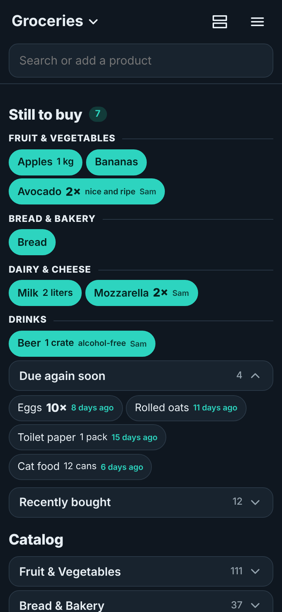
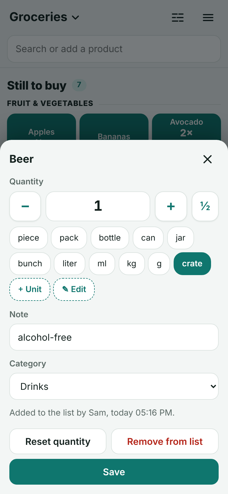
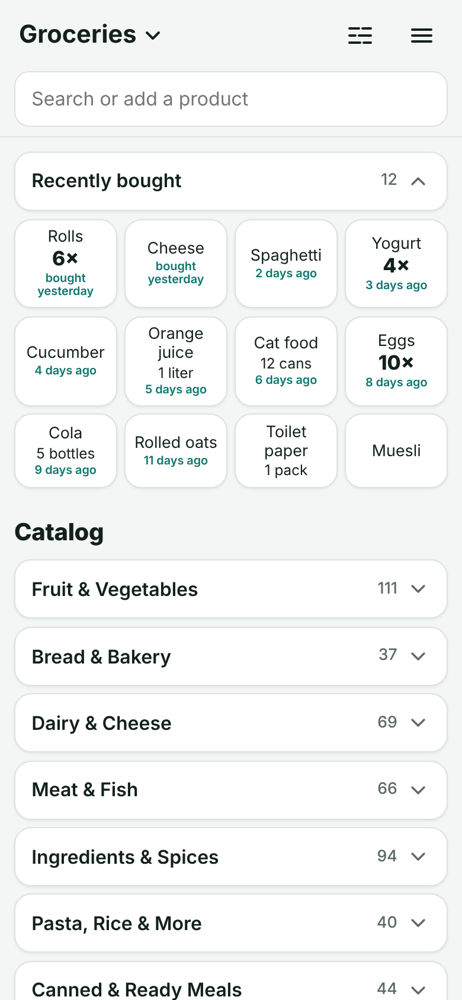
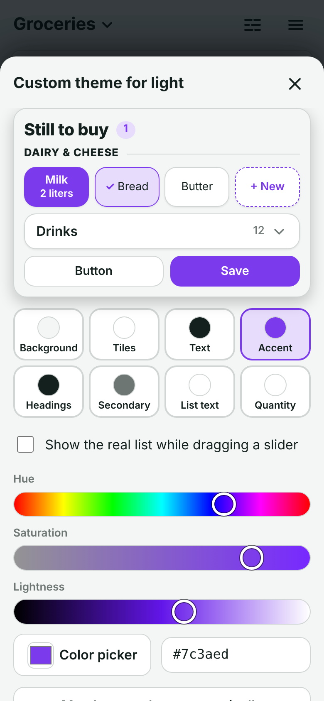
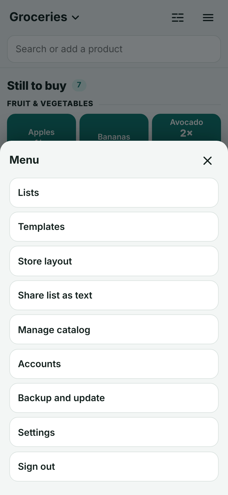

# Kaufen

[Deutsch](README.md) · **English**

[](#requirements)
[](#license)
[](https://ko-fi.com/burnersen)

**[⬇️ Download the latest release](../../releases/latest)** · **[🌐 Website](https://tech.burnersen.de/en/tools/kaufen-en/)** · **[☕ Buy me a coffee](https://ko-fi.com/burnersen)**

<sub>🇩🇪 Auf Deutsch: [tech.burnersen.de/tools/kaufen](https://tech.burnersen.de/tools/kaufen/)</sub>

Shared shopping lists you host yourself. The server side is PHP and SQLite, the browser side plain JavaScript and CSS. No frameworks, no dependencies, no build step, no MySQL. Runs on basic web hosting and is installed with a single file.

*Kaufen* is German for "to buy". You tap products from a ready-made catalog, sorted by category. In the store you tap them again and they are gone, for everyone who shares the list.

Upload `kaufen-install.php`, open it in the browser, create the first account. That is the whole installation.

<p align="center">
  
</p>

<table>
  <tr>
    <td align="center" width="33%"><br><sub>Shopping mode: large rows for ticking off</sub></td>
    <td align="center" width="33%"><br><sub>Dark and compact</sub></td>
    <td align="center" width="33%"><br><sub>Several at once, with preview</sub></td>
  </tr>
  <tr>
    <td align="center"><br><sub>Quantity, unit and note</sub></td>
    <td align="center"><br><sub>Recently bought</sub></td>
    <td align="center"><br><sub>Settings</sub></td>
  </tr>
  <tr>
    <td align="center"><br><sub>Color mixer for your own theme</sub></td>
    <td align="center"><br><sub>Menu</sub></td>
    <td align="center"><br><sub>Backup and update</sub></td>
  </tr>
</table>

<sub>Screenshots of version 1.11.1. Names and entries are made up.</sub>

> 💜 **Using Kaufen and happy with it?** A ⭐ on GitHub is the easiest way to let me know, and it does more than you'd think: stars are the visible proof that a project does good work, and they are how small projects like this one get found by other people in the first place. Or [tell me what you use it for](https://github.com/burnersen/kaufen/issues/new), I read every message. Thanks for being here!

## Contents

[Features](#features) · [Requirements](#requirements) · [Installation](#installation) · [Protecting your data](#protecting-your-data) · [Updating](#updating) · [Backup and restore](#backup-and-restore) · [Structure](#structure) · [Good to know](#good-to-know) · [License](#license)

## Features

### Shopping

- **Catalog** with about 810 products in 16 categories, in the order of a typical supermarket. Text only, no images.
- **Tap** to put a product on the list, tap it in the list to check it off. For a few seconds afterwards you can undo.
- **Search** across the whole catalog, in both languages: "milch" finds Milk as well. If a product does not exist, you create it right from the search and assign it to a category. Kaufen suggests the category from the end of the word: German compounds like “Bergkäse” land in dairy, “Hundefutter” in pet supplies.
- **Several at once, also by voice:** type or dictate “milk, 2 kg apples and half a bread” into the search field, press Enter, and everything is on the list. Items are split at commas, “and” or line breaks; without commas (“milk bread apples cream”) the catalog splits the words. Quantities may come before or after, in digits or words. While you type, a preview shows what was recognized.
- **Recently bought:** the latest and most frequent products, collapsible like the categories. What was bought in the last two weeks says so on the tile (“3 days ago”), a long-press shows the date and how often.
- **Due again soon:** when you tick things off, Kaufen learns how often you buy them (milk about every 5 days). When it is time again, it waits below the list, ready to tap. A product needs a few purchases for this. Everything stays on your own server, can be switched off per account or per product.
- **Three views:** small tiles, compact or shopping mode (large rows for ticking off in the store), switched with the button at the top right, remembered per device.
- **Keep shopping without a signal:** the app starts without reception, changes are collected and sent later.
- **Screen stays on** while the app is open (can be turned off).

### Quantities and notes

- **Quantity or note:** long-press (on a computer: right-click). The counter starts at 1 with no unit. Adjust it with plus and minus, tap a unit if you want one (piece, pack, liter, kg …) and add a note. A plain 1 is not shown on the tile, a number without a unit is shown large as “3×”. Halves work too: type “2.5” or “2 1/2” or tap the ½ button, it shows as 2½.
- **Custom units:** each account can add its own, such as "crate", "bag" or "roll", right in the quantity picker or in the settings. They can be renamed and deleted in both places. Quantities already saved stay as text.
- **Remembers quantities:** when you check a product off, Kaufen remembers what was on it. Bought five colas, and next time it says "5" again, visible on the tile, and one tap puts it on the list the same way. Each account can turn this off in the settings, then it always starts at 1. "Reset quantity" forgets the remembered quantity of a product.

### Shopping together

- **Sync across all devices:** your own changes go to the server right away. Only while Kaufen is open and visible and nothing is going on does the device ask every few seconds whether something has changed. The administrator can set the interval (1 to 60 seconds, default 5).
- **Multiple lists:** everyone can create lists and share them with any accounts. If you were invited, you can also leave a list again.
- **Who added it:** in shared lists the product shows who put it there. Each account can hide this in the settings.
- **Notifications on your phone:** if you like, you get a notification when someone puts something on a shared list. Each account turns this on or off per device in the settings. Bundled instead of one by one: three products make one notification, sent the moment the other person leaves Kaufen. Checking things off in the store does not notify anyone.
- **Share a list as text:** the open list goes to your messenger, mail and so on as plain text, or to the clipboard, for people without an account.
- **Store layout:** the categories can be ordered per list to match the way your own store is laid out.
- **Templates:** "BBQ" or "Breakfast" puts several products on the list with one tap. The current list can be saved as a template too.

### Language and look

- **German and English:** each account picks its language in the settings. A German device starts in German, all others in English. Everything is translated, including the catalog. In a shared list one person sees "Milch" and the other sees "Milk", and it is still the same entry.
- **Ten themes and your own colors:** five light and five dark color schemes, plus one custom theme each from the color mixer (sliders or color picker, with preview). There you can also pick the text colors for headings, secondary text, list text and quantity. One button matches them to the accent color automatically: easy-to-read list text and a quantity color from the color wheel that stands out from it. If you like, dragging a slider shows your real list instead of the preview. With "Same as device" Kaufen switches automatically between your light and your dark favorite. The look belongs to the account and applies on all devices.
- **Text sizes:** set per device in the settings, for everything at once or separately for headings, product names, quantity, count and note, plus how bold the count is. With a preview in the chosen view, or right on the real list while dragging if you like.
- **Installable as an app** (PWA), with its own icon on the home screen.

### Managing

- **Manage the catalog:** create, rename, move and delete products and categories. A search field filters the catalog, Enter creates what you searched for if it is missing. The administrator can export the whole catalog as CSV or JSON, edit it and import it again, always with German and English names. The administrator can also delete everything and restore the default. A backup is made automatically before every major change, the last 10 versions can be restored.
- **Accounts:** the first account is the administrator, who creates the others and can change their names and passwords at any time or delete accounts. There is no open sign-up.
- **Backup and update** (administrator, in the menu): download the whole database as one file and restore it, the previous state can be brought back. One-tap updates: Kaufen looks up the latest release on GitHub, verifies the file by checksum, saves the running version and installs the new one. Going back to the previous version takes one tap. If you like, Kaufen checks once a day by itself.
- **Throttling against password guessing:** after 5 wrong attempts for one name (or 20 from one address) you have to wait, 30 seconds at first, longer with every further failure, one hour at most.

## Requirements

- PHP 7.4 or newer (8.x recommended) with the `pdo_sqlite` extension
- A web server with PHP. **Apache** (and LiteSpeed) lock the internal folders by themselves via `.htaccess`, as long as the host honors `.htaccess` files, which almost every host does. **nginx** and other servers need two lines in their configuration, see [Protecting your data](#protecting-your-data).
- **HTTPS.** Without HTTPS the password travels in plain text, and the app cannot be installed on a phone.
- For notifications on your phone in addition: the `openssl` extension, plus `curl` or `allow_url_fopen`, and the web host must allow outgoing connections. If any of that is missing, Kaufen works as usual, just without notifications. The same goes for one-tap updates.

## Installation

1. Download `kaufen-install.php` from the [latest release](../../releases/latest) and copy it to a directory on your web server.
2. PHP must be allowed to write to that directory (it creates `index.php`, the folder `app/` and later `data/` there).
3. Open `kaufen-install.php` in the browser **right away** and click "Install now". The file unpacks the program, deletes itself and redirects. Create the first account there. This account is the administrator. If the installer says it could not delete itself, please delete the file by hand.
4. **Check that the internal folders are locked from the outside** (important, see [Protecting your data](#protecting-your-data)): open `https://your-address/data/config.php` and `https://your-address/app/routes/api.php`. Both must show "403 Forbidden" (or "404 Not Found"). A blank white page means the lock is not working.
5. In the menu under *Accounts* create the other accounts and invite them to the shared list in the same step.

> ⚠️ Whoever opens a freshly uploaded Kaufen that has not been set up yet becomes the administrator. So do step 3 immediately after uploading.

**Rather do it by hand?** The release also contains `kaufen-<version>.zip`. Unpack it and upload the contents of the folder `kaufen/`, that is `index.php` **and** the folder `app/`. Then open it in the browser and continue with step 4.

### On your phone

Open the address in the browser, sign in, then choose "Add to Home screen" in the browser menu (iPhone: Share → "Add to Home Screen"). From then on Kaufen starts like an app.

## Protecting your data

The folder `data/` holds everything worth protecting: the database with accounts, lists and settings, plus the key for notifications. Kaufen does quite a bit to keep it out of reach. A few things are up to you, though.

**1. Lock the internal folders.** Under Apache, Kaufen creates the necessary `.htaccess` files by itself. Under **nginx**, add these two lines to the site's `server` block. The `^~` matters: it makes the lock take precedence over the rule for `.php` files. Without it, nginx would still hand `data/config.php` over to PHP:

```nginx
# Kaufen lives in the folder /kaufen/ here. If it is in the web root, leave out /kaufen.
location ^~ /kaufen/data/ { deny all; }
location ^~ /kaufen/app/  { deny all; }
```

Back up the configuration first, then test and reload:

```sh
# Back up the configuration (path depends on your system, often /etc/nginx/sites-available/)
sudo cp -a /etc/nginx/sites-available/default /etc/nginx/sites-available/default.bak

# Test and reload
sudo nginx -t && sudo systemctl reload nginx

# If something goes wrong: restore and reload
sudo cp -a /etc/nginx/sites-available/default.bak /etc/nginx/sites-available/default && sudo systemctl reload nginx
```

Then repeat the check from [Installation, step 4](#installation). Kaufen needs no direct access to `app/`, even CSS and JavaScript are served through `index.php`.

If the lock ever fails, the database still cannot simply be downloaded: it has a random name that is only written in `data/config.php`, and a `.php` file cannot be downloaded from the outside. You should not rely on that alone, though.

**2. Keep backups safe.** The backup from the menu is the complete database: all accounts (passwords only as a hash), all lists and the key for notifications. It does not belong in a public cloud share, a chat or back in the web folder. The same goes for the folder `data/` itself, which never belongs in a public Git repository.

**3. Strong passwords.** At least 8 characters are required, more is better, especially for the administrator account.

**4. What goes out.** Kaufen loads nothing from third-party servers, no fonts, no scripts, no analytics. Only two features connect to the outside, and only if you use them:

- **Updates:** asks GitHub for the latest version. Nothing personal is sent. If you do not want this at all, add `'update_url' => ''` to `data/config.php`.
- **Notifications:** go from your own server to the notification service of the respective browser (Apple, Google, Mozilla, Microsoft). The content is encrypted for the device, the service itself cannot read it.

**5. What is not encrypted.** The shopping lists are stored as plain text in the database. Anyone with access to the web space (including your host) can read them.

## Updating

**From version 1.10.0 the easiest way:** in the menu, *Backup and update*, tap “Check for updates now” and then “Update now”. PHP must be allowed to overwrite the program files and to open outgoing connections (curl or `allow_url_fopen`). To switch it off, set `'update_url' => ''` in `data/config.php`.

By hand: upload the new `kaufen-install.php` and open it. Only the program files are replaced, the folder `data/` is left untouched.

A backup before an update never hurts, see the next section.

## Backup and restore

**Easiest in the menu** under *Backup and update*: "Download backup" saves the whole database as one file, "Restore backup …" brings it back. The state before restoring is kept and can be brought back there with one tap.

**By hand via SSH** (in the Kaufen directory). The backup goes to your home directory, outside the web folder, so nobody can fetch it through the browser. Best done while nobody is shopping:

```sh
# Create a backup
cp -a data ~/kaufen-backup-$(date +%Y%m%d-%H%M)

# Restore: move the current state aside (also outside the web folder),
# then put the backup in place (insert the name of your backup)
mv data ~/kaufen-data-before-$(date +%Y%m%d-%H%M) && cp -a ~/kaufen-backup-YYYYMMDD-HHMM data
```

Without SSH: download the folder `data/` via FTP and upload it again to restore. Keep the downloaded copy safe, see [Protecting your data](#protecting-your-data).

## Structure

```
index.php      entry point and settings (PHP)
app/lib/       language, database, accounts and sign-in, lists and catalog, default catalog, notifications, backup and update (PHP)
app/routes/    all JSON actions (PHP)
app/views/     sign-in page and main page (PHP/HTML)
app/assets/    the app in the browser (JavaScript, CSS), English translation, icons, service worker
data/          created on first start, holds the database and accounts
tools/         builds the release files (php tools/build-release.php)
```

The files in `app/` do nothing when called directly, everything goes through `index.php`. Under Apache an `.htaccess` blocks the folder as well. The default catalog lives in `app/lib/catalog.php` and can be adjusted there. The English texts and product names are in `app/assets/i18n.js`, the English server messages in `app/lib/lang.php`. Comments in the source code are in German.

## Good to know

- **Notifications:** on the iPhone they only work when Kaufen is installed via "Add to Home Screen" (iOS 16.4 or later), on Android and on a computer they also work in the browser. When you turn them on, the server sends a test, so you see right away whether it can reach the notification service. If a device does not say goodbye when leaving (no signal), the notification goes out about three minutes after the last change, as soon as any device has Kaufen open again.
- **Language:** the built-in catalog is stored in German in the database and is only translated for display on English accounts. Products, categories and templates you create yourself stay exactly as typed.
- **What belongs to whom:** remembered quantities belong to the list and apply to everyone sharing it. Language, "remember quantity", "who added it", custom units and the look belong to the account. View and text sizes only apply to the device.
- **Catalog and templates** apply to all accounts and all lists. Any account may change individual products and categories. "Delete everything", "Restore default", export and import and the backups are reserved for the administrator.
- **Lists** are only visible to their members. Only the person who created a list can share, rename and delete it. When an account is deleted, its lists go to the administrator so nothing is lost.
- **Signing in:** a device stays signed in for 180 days as long as it is used. Changing your password signs out all your other devices. When the administrator sets a new password for an account, all devices of that account are signed out. Renaming keeps them signed in.
- **Limits:** at most 50 accounts, at most 30 own lists per account.
- **Behind a proxy** (such as Cloudflare or a reverse proxy in front), all requests look to Kaufen as if they came from the same address. The throttling against password guessing then counts for everyone together. Per name it still applies separately.

## ☕ Support

Kaufen is free and made in my spare time, on my own hardware and electricity bill. If it saved you time and you'd like to say thanks, you can [drop a little something in the tip jar on Ko-fi](https://ko-fi.com/burnersen), it keeps motivation and coffee flowing. ☕ Completely optional, and either way: thank you for using it!

## License

GNU Affero General Public License v3.0, see [LICENSE](LICENSE).
