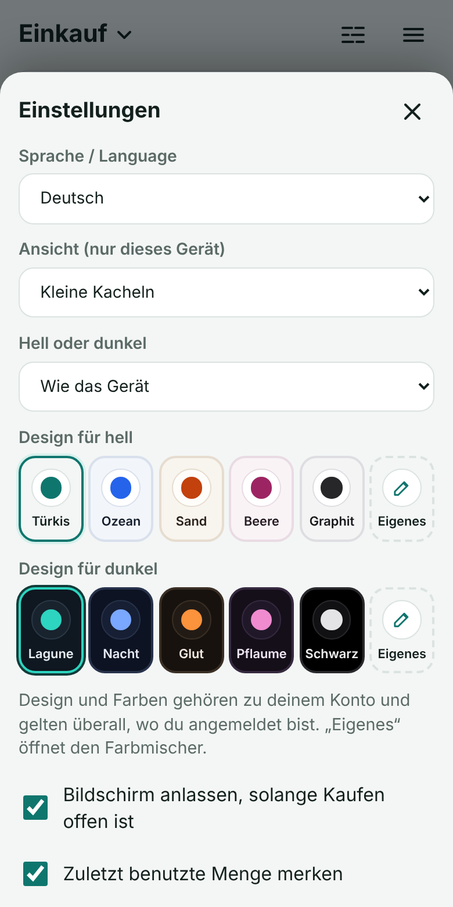

# Kaufen

**Deutsch** · [English](README.en.md)

[](#voraussetzungen)
[](#lizenz)
[](https://ko-fi.com/burnersen)

**[⬇️ Neuestes Release herunterladen](../../releases/latest)** · **[🌐 Webseite](https://tech.burnersen.de/tools/kaufen/)** · **[☕ Spendier mir einen Kaffee](https://ko-fi.com/burnersen)**

<sub>🇬🇧 In English: [tech.burnersen.de/en/tools/kaufen-en](https://tech.burnersen.de/en/tools/kaufen-en/)</sub>

Gemeinsame Einkaufslisten zum Selbsthosten in **reinem PHP**, installiert mit einer einzigen Datei. Keine Abhängigkeiten, kein Build-Schritt, kein MySQL, keine Abrufe bei fremden Servern. Läuft auf einfachem Webspace.

Produkte tippt man aus einem fertigen Katalog an, sortiert nach Warengruppen. Im Laden tippt man sie wieder an, dann sind sie weg, und zwar bei allen, die die Liste teilen.

`kaufen-install.php` hochladen, im Browser öffnen, erstes Konto anlegen. Das ist die ganze Installation.


<p>
  
  
  
</p>

*Menge wählen, Einstellungen mit Sprache und Designs, Farbmischer fürs eigene Design. Beispieldaten, erfunden für die Screenshots.*

> 💜 **Gefällt dir Kaufen?** Ein ⭐ auf GitHub ist die einfachste Art, mir das zu sagen, und es bringt mehr, als man denkt: Sterne sind der sichtbare Beweis, dass ein Projekt gute Arbeit leistet, und genau darüber finden andere kleine Projekte wie dieses überhaupt erst Leute. Oder [erzähl mir, wofür du es nutzt](https://github.com/burnersen/kaufen/issues/new), ich lese jede Nachricht. Danke, dass du da bist!

## Funktionen

- **Deutsch und Englisch:** jedes Konto wählt seine Sprache in den Einstellungen, ein deutsches Gerät startet deutsch, alle anderen englisch. Übersetzt ist alles, auch der Katalog. In einer geteilten Liste sieht die eine „Milch“ und der andere „Milk“, es bleibt derselbe Eintrag.
- **Katalog** mit rund 810 Produkten in 16 Warengruppen, in der Reihenfolge eines typischen Supermarkts. Nur Text, keine Bilder.
- **Antippen** setzt ein Produkt auf die Liste, Antippen in der Liste hakt es ab. Danach gibt es ein paar Sekunden lang „Rückgängig“.
- **Abgleich zwischen allen Geräten:** eigene Änderungen gehen sofort an den Server. Nur solange Kaufen offen und zu sehen ist und gerade nichts passiert, fragt das Gerät alle paar Sekunden nach, ob sich etwas geändert hat. Der Abstand ist für den Administrator einstellbar (1 bis 60 Sekunden, voreingestellt 5).
- **Suche** über den ganzen Katalog, in beiden Sprachen: „milk“ findet auch Milch. Gibt es ein Produkt nicht, legt man es direkt aus der Suche an und ordnet es einer Warengruppe zu.
- **Menge oder Hinweis:** lange drücken (am Rechner: Rechtsklick). Im Zähler steht erst einmal 1, ohne Einheit. Mit Plus und Minus einstellen, bei Bedarf eine Einheit antippen (Stück, Packung, Liter, kg …) und einen Hinweis dazuschreiben. Eine schlichte 1 wird an der Kachel nicht eigens angezeigt, eine Zahl ohne Einheit steht groß als „3ד da. Halbe gehen auch: „2,5“ oder „2 1/2“ tippen oder den Knopf ½ drücken, angezeigt wird 2½.
- **Eigene Einheiten:** „Kasten“, „Beutel“ oder „Rolle“ legt jedes Konto selbst an, direkt in der Mengenauswahl oder in den Einstellungen.
- **Menge merken:** beim Abhaken merkt sich Kaufen, was am Produkt stand. Fünfmal Cola gekauft, dann steht beim nächsten Mal wieder „5“ da, schon an der Kachel zu sehen, und ein Tipp setzt es genauso auf die Liste. Jedes Konto kann das in den Einstellungen abschalten, dann steht immer 1 da. „Menge zurücksetzen“ vergisst die gemerkte Menge eines Produkts.
- **Zuletzt gekauft:** die jüngsten und häufigsten Produkte, zum Aufklappen wie die Warengruppen.
- **Zehn Designs und eigene Farben:** fünf helle und fünf dunkle Farbwelten, dazu je ein eigenes Design aus dem Farbmischer (Regler oder Farbwähler, mit Vorschau). Dort lassen sich auch die Schriftfarben für Überschriften, Nebentext, Listenschrift und Menge selbst wählen, sonst rechnet Kaufen sie passend aus. Bei „Wie das Gerät“ wechselt Kaufen automatisch zwischen dem hellen und dem dunklen Favoriten. Das Aussehen gehört zum Konto und gilt auf allen Geräten.
- **Mehrere Listen:** jeder kann eigene Listen anlegen und mit beliebigen Konten teilen.
- **Mitteilungen aufs Handy:** wer möchte, bekommt eine Mitteilung, wenn jemand etwas auf eine geteilte Liste setzt. Jedes Konto schaltet das pro Gerät in den Einstellungen ein oder aus. Gebündelt statt einzeln: drei Produkte ergeben eine Mitteilung, und zwar in dem Moment, in dem der andere Kaufen verlässt. Abhaken im Laden meldet nichts.
- **Liste als Text teilen:** die offene Liste geht als schlichter Text an WhatsApp, Mail und Co. oder in die Zwischenablage, für Leute ohne Konto.
- **Reihenfolge im Laden:** die Warengruppen lassen sich pro Liste so sortieren, wie der eigene Laden aufgebaut ist.
- **Vorlagen:** „Grillen“ oder „Frühstück“ setzt mit einem Tipp mehrere Produkte auf die Liste. Auch die aktuelle Liste lässt sich als Vorlage speichern.
- **Ohne Netz weiter einkaufen:** die App startet auch ohne Empfang, Änderungen werden gesammelt und nachgereicht.
- **Wer war's:** in geteilten Listen steht am Produkt, wer es draufgesetzt hat.
- **Bildschirm bleibt an**, solange die App offen ist (abschaltbar).
- **Katalog verwalten:** Produkte und Warengruppen anlegen, umbenennen, verschieben, löschen. Der Administrator kann den ganzen Katalog als CSV oder JSON exportieren, bearbeiten und wieder importieren, jeweils mit deutschem und englischem Namen. Ein Suchfeld filtert den Katalog, Enter legt das Gesuchte neu an, wenn es noch fehlt. Der Administrator kann alles löschen und den Standard wiederherstellen. Vor jeder großen Änderung wird automatisch gesichert, die letzten 10 Stände lassen sich zurückholen.
- **Konten:** das erste Konto ist der Administrator, er legt die anderen an. Eine offene Registrierung gibt es nicht.
- **Drei Ansichten:** kleine Kacheln, kompakt oder Laden-Modus (große Zeilen fürs Abhaken im Laden), umschaltbar mit dem Knopf oben rechts, gemerkt pro Gerät.
- **Schriftgrößen:** in den Einstellungen pro Gerät, für alles zusammen oder einzeln für Überschriften, Produktnamen, Menge, Anzahl und Hinweis, dazu wie fett die Anzahl ist. Mit Vorschau in der gewählten Ansicht.
- Als App installierbar (PWA), heller und dunkler Modus, Bremse gegen das Durchprobieren von Passwörtern.

## Voraussetzungen

- PHP 7.4 oder neuer (empfohlen 8.x) mit der Erweiterung `pdo_sqlite`
- Für Mitteilungen aufs Handy zusätzlich: die Erweiterung `openssl`, dazu `curl` oder `allow_url_fopen`, und der Webspace muss ausgehende Verbindungen erlauben. Fehlt etwas davon, läuft Kaufen ganz normal, nur ohne Mitteilungen.
- Ein Webserver mit PHP (Apache läuft ohne Zutun)
- **HTTPS.** Ohne HTTPS geht das Passwort im Klartext durchs Netz, und die App lässt sich nicht aufs Handy installieren.

## Installation

1. Aus dem [neuesten Release](../../releases/latest) die Datei `kaufen-install.php` herunterladen und in ein Verzeichnis auf dem Webserver kopieren.
2. PHP muss in dieses Verzeichnis schreiben dürfen (es legt dort `index.php`, den Ordner `app/` und später `data/` an).
3. `kaufen-install.php` **sofort** im Browser aufrufen und auf „Jetzt installieren“ klicken. Die Datei packt das Programm aus, löscht sich selbst und leitet weiter. Dort das erste Konto anlegen. Dieses Konto ist der Administrator.
4. Prüfen, dass `data/` von außen nicht erreichbar ist: `https://deine-adresse/data/config.php` muss „403 Forbidden“ zeigen.
5. Im Menü unter *Konten* die weiteren Konten anlegen und dabei gleich in die gemeinsame Liste einladen.

> Wer ein frisch hochgeladenes, noch nicht eingerichtetes Kaufen als Erster aufruft, wird Administrator. Schritt 3 also direkt nach dem Hochladen erledigen.

**Lieber von Hand?** Im Release liegt auch `kaufen-<Version>.zip`. Entpacken und den Inhalt des Ordners `kaufen/` hochladen, also `index.php` **und** den Ordner `app/`.

### Aufs Handy

Die Adresse im Browser öffnen, anmelden, dann im Browser-Menü „Zum Startbildschirm hinzufügen“ (iPhone: Teilen → „Zum Home-Bildschirm“). Danach startet Kaufen wie eine App.

## Aktualisieren

Den neuen `kaufen-install.php` hochladen und aufrufen. Ersetzt werden nur die Programmdateien, der Ordner `data/` bleibt unangetastet.

Vorher sichern, und so geht es wieder zurück (im Verzeichnis von Kaufen, per SSH):

```sh
# Sicherung anlegen
cp -a data "data-sicherung-$(date +%Y%m%d-%H%M)"

# Zurückholen (Namen der Sicherung einsetzen)
mv data data-kaputt && cp -a data-sicherung-JJJJMMTT-HHMM data
```

Ohne SSH: den Ordner `data/` per FTP herunterladen und zum Zurückholen wieder hochladen.

## Aufbau

```
index.php      Einstieg und Einstellungen
app/lib/       Sprache, Datenbank, Konten und Anmeldung, Listen und Katalog, Standardkatalog, Mitteilungen
app/routes/    alle JSON-Aktionen
app/views/     Anmeldeseite und Hauptseite
app/assets/    CSS, JavaScript, englische Übersetzung, Symbole, Service Worker
data/          entsteht beim ersten Start, hier liegen Datenbank und Konten
tools/         baut die Release-Dateien (php tools/build-release.php)
```

Die Dateien in `app/` tun nichts, wenn man sie direkt aufruft, alles läuft über `index.php`. Unter Apache sperrt eine `.htaccess` den Ordner zusätzlich. Der Standardkatalog steht in `app/lib/catalog.php` und lässt sich dort anpassen. Die englischen Texte und Produktnamen stehen in `app/assets/i18n.js`, die englischen Meldungen des Servers in `app/lib/lang.php`.

## Gut zu wissen

- **Mitteilungen:** auf dem iPhone gehen sie nur, wenn Kaufen über „Zum Home-Bildschirm“ installiert ist (ab iOS 16.4), auf Android und am Rechner auch im Browser. Beim Einschalten schickt der Server eine Probe, so sieht man sofort, ob er den Mitteilungsdienst erreicht. Verschickt wird direkt vom eigenen Server an den Mitteilungsdienst des Browsers (Apple, Google, Mozilla, Microsoft), verschlüsselt für das jeweilige Gerät, ohne weiteren Dienst dazwischen. Meldet sich ein Gerät beim Verlassen nicht ab (Funkloch), geht die Mitteilung rund drei Minuten nach der letzten Änderung raus, sobald irgendein Gerät Kaufen das nächste Mal offen hat.

- Der mitgelieferte Katalog liegt deutsch in der Datenbank und wird für englische Konten nur bei der Anzeige übersetzt. Selbst angelegte Produkte, Warengruppen und Vorlagen bleiben so, wie sie getippt wurden.
- Die gemerkten Mengen gehören zur Liste und gelten für alle, die sie teilen. Sprache, „Menge merken“, eigene Einheiten und das Aussehen gehören zum Konto.
- Der Katalog und die Vorlagen gelten für alle Konten und alle Listen. Einzelne Produkte und Warengruppen darf jedes Konto ändern, „Alles löschen“, „Standard wiederherstellen“ und die Sicherungen sind dem Administrator vorbehalten.
- Listen sehen nur ihre Mitglieder. Teilen, umbenennen und löschen kann nur, wer die Liste angelegt hat.
- Passwörter liegen nur als Prüfsumme (`password_hash`) in der Datenbank. Die Einkaufslisten selbst sind nicht verschlüsselt, wer Zugriff auf den Webspace hat, kann sie lesen.
- Ein Gerät bleibt 180 Tage angemeldet, solange es benutzt wird. Wer sein Passwort ändert, meldet alle anderen Geräte ab.

## ☕ Unterstützen

Kaufen ist kostenlos und entsteht in meiner Freizeit, auf meiner eigenen Hardware und Stromrechnung. Wenn es dir Zeit gespart hat und du Danke sagen möchtest, kannst du [ein kleines Trinkgeld bei Ko-fi dalassen](https://ko-fi.com/burnersen), das hält Motivation und Kaffee am Laufen. ☕ Völlig freiwillig, und in jedem Fall: danke fürs Benutzen!

## Lizenz

GNU Affero General Public License v3.0, siehe [LICENSE](LICENSE).
