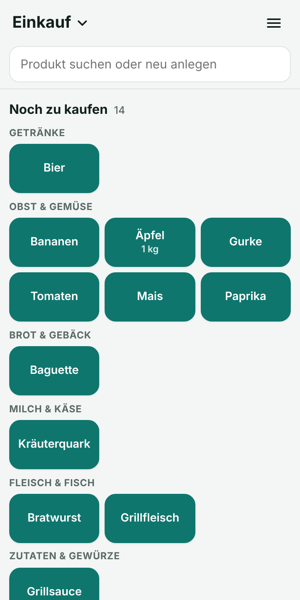

# Kaufen

Gemeinsame Einkaufslisten zum Selbsthosten in **reinem PHP**, installiert mit einer einzigen Datei. Keine Abhängigkeiten, kein Build-Schritt, kein MySQL, keine Abrufe bei fremden Servern. Läuft auf einfachem Webspace.

Produkte tippt man aus einem fertigen Katalog an, sortiert nach Warengruppen. Im Laden tippt man sie wieder an, dann sind sie weg, und zwar bei allen, die die Liste teilen.

`kaufen-install.php` hochladen, im Browser öffnen, erstes Konto anlegen. Das ist die ganze Installation.



*Beispieldaten, erfunden für den Screenshot.*

## Funktionen

- **Katalog** mit rund 520 Produkten in 16 Warengruppen, in der Reihenfolge eines typischen Supermarkts. Nur Text, keine Bilder.
- **Antippen** setzt ein Produkt auf die Liste, Antippen in der Liste hakt es ab. Danach gibt es ein paar Sekunden lang „Rückgängig“.
- **Abgleich zwischen allen Geräten:** jedes Gerät fragt alle paar Sekunden nach, ob sich etwas geändert hat. Der Abstand ist für den Administrator einstellbar (1 bis 60 Sekunden, voreingestellt 5).
- **Suche** über den ganzen Katalog. Gibt es ein Produkt nicht, legt man es direkt aus der Suche an und ordnet es einer Warengruppe zu.
- **Menge oder Hinweis:** lange drücken (am Rechner: Rechtsklick), dann zum Beispiel „2 Liter“ dazuschreiben.
- **Zuletzt gekauft:** die jüngsten und häufigsten Produkte stehen ganz oben.
- **Mehrere Listen:** jeder kann eigene Listen anlegen und mit beliebigen Konten teilen.
- **Reihenfolge im Laden:** die Warengruppen lassen sich pro Liste so sortieren, wie der eigene Laden aufgebaut ist.
- **Vorlagen:** „Grillen“ oder „Frühstück“ setzt mit einem Tipp mehrere Produkte auf die Liste. Auch die aktuelle Liste lässt sich als Vorlage speichern.
- **Ohne Netz weiter einkaufen:** die App startet auch ohne Empfang, Änderungen werden gesammelt und nachgereicht.
- **Wer war's:** in geteilten Listen steht am Produkt, wer es draufgesetzt hat.
- **Bildschirm bleibt an**, solange die App offen ist (abschaltbar).
- **Katalog verwalten:** Produkte und Warengruppen anlegen, umbenennen, verschieben, löschen. Der Administrator kann alles löschen und den Standard wiederherstellen. Vor jeder großen Änderung wird automatisch gesichert, die letzten 10 Stände lassen sich zurückholen.
- **Konten:** das erste Konto ist der Administrator, er legt die anderen an. Eine offene Registrierung gibt es nicht.
- Als App installierbar (PWA), heller und dunkler Modus, Bremse gegen das Durchprobieren von Passwörtern.

## Voraussetzungen

- PHP 7.4 oder neuer (empfohlen 8.x) mit der Erweiterung `pdo_sqlite`
- Ein Webserver mit PHP (Apache läuft ohne Zutun)
- **HTTPS.** Ohne HTTPS geht das Passwort im Klartext durchs Netz, und die App lässt sich nicht aufs Handy installieren.

## Installation

1. Aus dem [neuesten Release](../../releases/latest) die Datei `kaufen-install.php` herunterladen und in ein Verzeichnis auf dem Webserver kopieren.
2. PHP muss in dieses Verzeichnis schreiben dürfen (es legt dort `index.php`, den Ordner `app/` und später `data/` an).
3. `kaufen-install.php` **sofort** im Browser aufrufen und auf „Jetzt installieren“ klicken. Die Datei packt das Programm aus, löscht sich selbst und leitet weiter. Dort das erste Konto anlegen. Dieses Konto ist der Administrator.
4. Prüfen, dass `data/` von außen nicht erreichbar ist: `https://deine-adresse/data/config.php` muss „403 Forbidden“ zeigen.
5. Im Menü unter *Konten* die weiteren Konten anlegen und dabei gleich in die gemeinsame Liste einladen.

> Wer ein frisch hochgeladenes, noch nicht eingerichtetes Kaufen als Erster aufruft, wird Administrator. Schritt 3 also direkt nach dem Hochladen erledigen.

**Lieber von Hand?** Im Release liegt auch `kaufen-<Version>.zip`. Entpacken und den Inhalt des Ordners `kaufen/` hochladen, also `index.php` **und** den Ordner `app/`.

### Aufs Handy

Die Adresse im Browser öffnen, anmelden, dann im Browser-Menü „Zum Startbildschirm hinzufügen“ (iPhone: Teilen → „Zum Home-Bildschirm“). Danach startet Kaufen wie eine App.

## Aktualisieren

Den neuen `kaufen-install.php` hochladen und aufrufen. Ersetzt werden nur die Programmdateien, der Ordner `data/` bleibt unangetastet.

Vorher sichern, und so geht es wieder zurück (im Verzeichnis von Kaufen, per SSH):

```sh
# Sicherung anlegen
cp -a data "data-sicherung-$(date +%Y%m%d-%H%M)"

# Zurückholen (Namen der Sicherung einsetzen)
mv data data-kaputt && cp -a data-sicherung-JJJJMMTT-HHMM data
```

Ohne SSH: den Ordner `data/` per FTP herunterladen und zum Zurückholen wieder hochladen.

## Aufbau

```
index.php      Einstieg und Einstellungen
app/lib/       Datenbank, Konten und Anmeldung, Listen und Katalog, Standardkatalog
app/routes/    alle JSON-Aktionen
app/views/     Anmeldeseite und Hauptseite
app/assets/    CSS, JavaScript, Symbole, Service Worker
data/          entsteht beim ersten Start, hier liegen Datenbank und Konten
tools/         baut die Release-Dateien (php tools/build-release.php)
```

Die Dateien in `app/` tun nichts, wenn man sie direkt aufruft, alles läuft über `index.php`. Unter Apache sperrt eine `.htaccess` den Ordner zusätzlich. Der Standardkatalog steht in `app/lib/catalog.php` und lässt sich dort anpassen.

## Gut zu wissen

- Der Katalog und die Vorlagen gelten für alle Konten und alle Listen. Einzelne Produkte und Warengruppen darf jedes Konto ändern, „Alles löschen“, „Standard wiederherstellen“ und die Sicherungen sind dem Administrator vorbehalten.
- Listen sehen nur ihre Mitglieder. Teilen, umbenennen und löschen kann nur, wer die Liste angelegt hat.
- Passwörter liegen nur als Prüfsumme (`password_hash`) in der Datenbank. Die Einkaufslisten selbst sind nicht verschlüsselt, wer Zugriff auf den Webspace hat, kann sie lesen.
- Ein Gerät bleibt 180 Tage angemeldet, solange es benutzt wird. Wer sein Passwort ändert, meldet alle anderen Geräte ab.

## Lizenz

GNU Affero General Public License v3.0, siehe [LICENSE](LICENSE).
