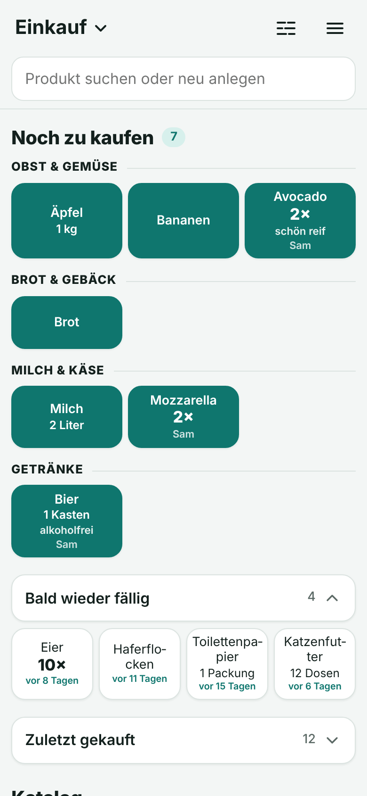
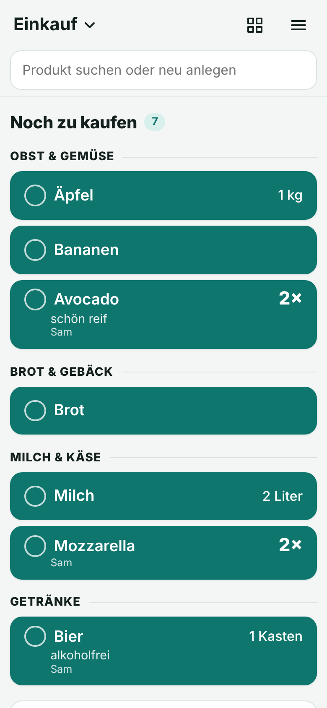
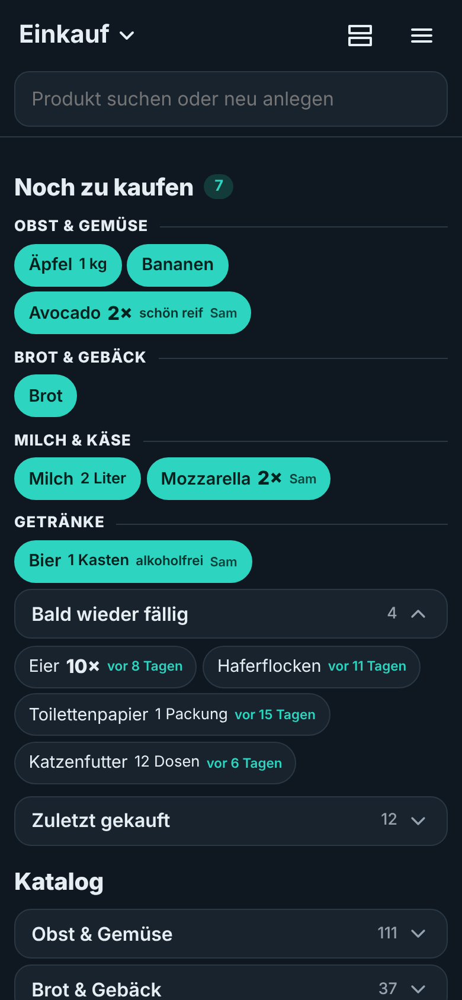
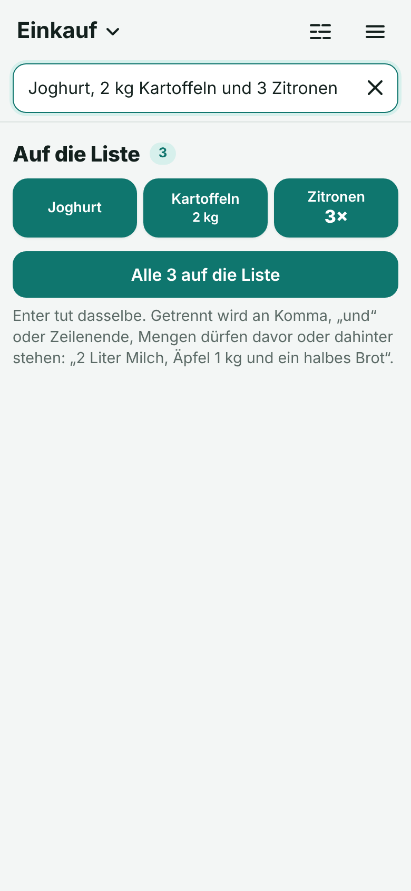
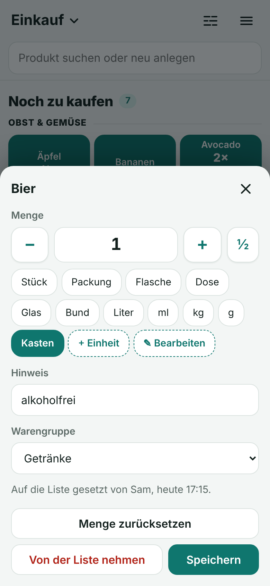
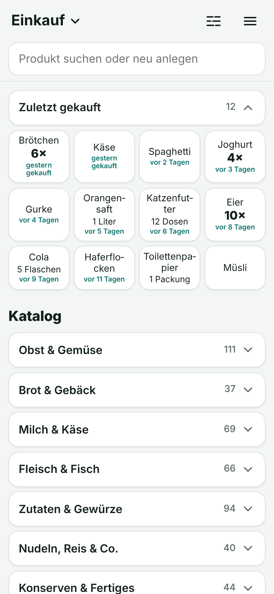
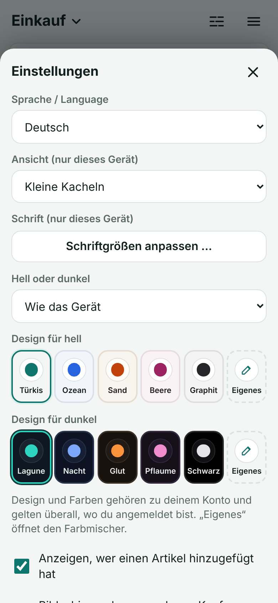
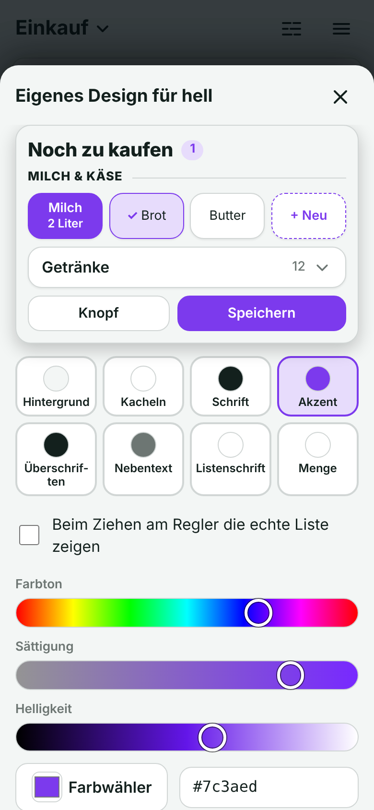
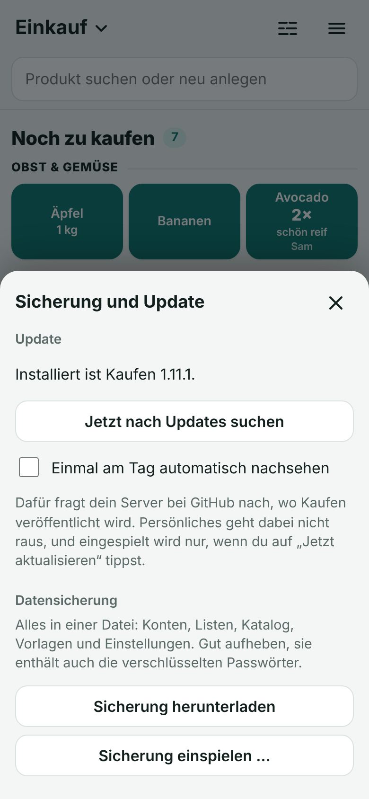

# Kaufen

**Deutsch** · [English](README.en.md)

[](#voraussetzungen)
[](#lizenz)
[](https://ko-fi.com/burnersen)

**[⬇️ Neuestes Release herunterladen](../../releases/latest)** · **[🌐 Webseite](https://tech.burnersen.de/tools/kaufen/)** · **[☕ Spendier mir einen Kaffee](https://ko-fi.com/burnersen)**

<sub>🇬🇧 In English: [tech.burnersen.de/en/tools/kaufen-en](https://tech.burnersen.de/en/tools/kaufen-en/)</sub>

Gemeinsame Einkaufslisten zum Selbsthosten. Auf dem Server laufen PHP und SQLite, im Browser schlichtes JavaScript und CSS. Keine Frameworks, keine Abhängigkeiten, kein Build-Schritt, kein MySQL. Läuft auf einfachem Webspace und wird mit einer einzigen Datei installiert.

Produkte tippt man aus einem fertigen Katalog an, sortiert nach Warengruppen. Im Laden tippt man sie wieder an, dann sind sie weg, und zwar bei allen, die die Liste teilen.

`kaufen-install.php` hochladen, im Browser öffnen, erstes Konto anlegen. Das ist die ganze Installation.

<p align="center">
  
</p>

<table>
  <tr>
    <td align="center" width="33%"><br><sub>Laden-Modus: große Zeilen zum Abhaken</sub></td>
    <td align="center" width="33%"><br><sub>Dunkel und kompakt</sub></td>
    <td align="center" width="33%"><br><sub>Mehrere auf einmal, mit Vorschau</sub></td>
  </tr>
  <tr>
    <td align="center"><br><sub>Menge, Einheit und Hinweis</sub></td>
    <td align="center"><br><sub>Zuletzt gekauft</sub></td>
    <td align="center"><br><sub>Einstellungen</sub></td>
  </tr>
  <tr>
    <td align="center"><br><sub>Farbmischer fürs eigene Design</sub></td>
    <td align="center"><br><sub>Menü</sub></td>
    <td align="center"><br><sub>Sicherung und Update</sub></td>
  </tr>
  <tr>
    <td align="center"><br><sub>Drucken und Teilen</sub></td>
    <td align="center"><br><sub>Aus Text einfügen</sub></td>
    <td align="center"><br><sub>Der Zettel zum Ausdrucken</sub></td>
  </tr>
</table>

<sub>Screenshots von Version 1.11.1 und 1.13.0. Namen und Einträge sind erfunden.</sub>

> 💜 **Gefällt dir Kaufen?** Ein ⭐ auf GitHub ist die einfachste Art, mir das zu sagen, und es bringt mehr, als man denkt: Sterne sind der sichtbare Beweis, dass ein Projekt gute Arbeit leistet, und genau darüber finden andere kleine Projekte wie dieses überhaupt erst Leute. Oder [erzähl mir, wofür du es nutzt](https://github.com/burnersen/kaufen/issues/new), ich lese jede Nachricht. Danke, dass du da bist!

## Inhalt

[Funktionen](#funktionen) · [Voraussetzungen](#voraussetzungen) · [Installation](#installation) · [Daten schützen](#daten-schützen) · [Aktualisieren](#aktualisieren) · [Sichern und Zurückholen](#sichern-und-zurückholen) · [Aufbau](#aufbau) · [Gut zu wissen](#gut-zu-wissen) · [Lizenz](#lizenz)

## Funktionen

### Einkaufen

- **Katalog** mit rund 810 Produkten in 16 Warengruppen, in der Reihenfolge eines typischen Supermarkts. Nur Text, keine Bilder.
- **Antippen** setzt ein Produkt auf die Liste, Antippen in der Liste hakt es ab. Danach gibt es ein paar Sekunden lang „Rückgängig“.
- **Suche** über den ganzen Katalog, in beiden Sprachen: „milk“ findet auch Milch. Gibt es ein Produkt nicht, legt man es direkt aus der Suche an und ordnet es einer Warengruppe zu. Die passende Warengruppe schlägt Kaufen am Wortende vor: „Bergkäse“ landet bei Milch & Käse, „Hundefutter“ bei Tierbedarf.
- **Mehrere auf einmal, auch per Sprache:** „Milch, 2 kg Äpfel und ein halbes Brot“ ins Suchfeld tippen oder diktieren, Enter, und alles steht auf der Liste. Getrennt wird an Komma, „und“ oder Zeilenende, ohne Kommas („Milch Brot Äpfel Sahne“) zerlegt der Katalog die Wörter. Mengen dürfen davor oder dahinter stehen, in Ziffern oder Worten. Schon beim Tippen zeigt eine Vorschau, was erkannt wurde.
- **Zuletzt gekauft:** die jüngsten und häufigsten Produkte, zum Aufklappen wie die Warengruppen. Was in den letzten zwei Wochen gekauft wurde, sagt es an der Kachel dazu („vor 3 Tagen“), beim langen Drücken mit Datum und wie oft.
- **Bald wieder fällig:** beim Abhaken lernt Kaufen, wie oft ihr etwas kauft (Milch etwa alle 5 Tage). Ist es wieder so weit, steht es unter der Liste zum Antippen bereit. Ein Produkt braucht dafür ein paar Einkäufe. Alles bleibt auf dem eigenen Server, abschaltbar pro Konto oder pro Produkt.
- **Drei Ansichten:** kleine Kacheln, kompakt oder Laden-Modus (große Zeilen fürs Abhaken im Laden), umschaltbar mit dem Knopf oben rechts, gemerkt pro Gerät.
- **Ohne Netz weiter einkaufen:** die App startet auch ohne Empfang, Änderungen werden gesammelt und nachgereicht.
- **Bildschirm bleibt an**, solange die App offen ist (abschaltbar).

### Mengen und Hinweise

- **Menge oder Hinweis:** lange drücken (am Rechner: Rechtsklick). Im Zähler steht erst einmal 1, ohne Einheit. Mit Plus und Minus einstellen, bei Bedarf eine Einheit antippen (Stück, Packung, Liter, kg …) und einen Hinweis dazuschreiben. Eine schlichte 1 wird an der Kachel nicht eigens angezeigt, eine Zahl ohne Einheit steht groß als „3ד da. Halbe gehen auch: „2,5“ oder „2 1/2“ tippen oder den Knopf ½ drücken, angezeigt wird 2½.
- **Einzahl und Mehrzahl auf einem Knopf:** „Glas“ steht bei 1 da, ab 2 heißt derselbe Knopf „Gläser“. Diktieren und Tippen verstehen beide Formen, „eine Kiste Wasser“ genauso wie „zwei Kisten Wasser“.
- **Mehr Einheiten:** neben Stück, Packung, Liter, kg und Co. gibt es Kiste, Kasten, Becher, Beutel, Tüte, Netz, Schale, Rolle, Tafel, Tube, Sack, Scheibe, Kopf, Zehe, Würfel, Stange und Portion. In den Einstellungen legst du fest, welche bei der Mengenauswahl immer dastehen, der Rest wartet unter „Weitere …“.
- **Eigene Einheiten:** z. B. „Eimer“ legt jedes Konto selbst an, mit Einzahl und Mehrzahl, direkt in der Mengenauswahl oder in den Einstellungen. Die Mehrzahl wird vorgeschlagen (Kanne wird Kannen). Umbenennen und löschen geht an beiden Stellen. Schon gespeicherte Mengen bleiben dabei als Text stehen.
- **Menge merken:** beim Abhaken merkt sich Kaufen, was am Produkt stand. Fünfmal Cola gekauft, dann steht beim nächsten Mal wieder „5“ da, schon an der Kachel zu sehen, und ein Tipp setzt es genauso auf die Liste. Jedes Konto kann das in den Einstellungen abschalten, dann steht immer 1 da. „Menge zurücksetzen“ vergisst die gemerkte Menge eines Produkts.

### Gemeinsam einkaufen

- **Abgleich zwischen allen Geräten:** eigene Änderungen gehen sofort an den Server. Nur solange Kaufen offen und zu sehen ist und gerade nichts passiert, fragt das Gerät alle paar Sekunden nach, ob sich etwas geändert hat. Der Abstand ist für den Administrator einstellbar (1 bis 60 Sekunden, voreingestellt 5).
- **Mehrere Listen:** jeder kann eigene Listen anlegen und mit beliebigen Konten teilen. Wer eingeladen wurde, kann eine Liste auch wieder verlassen.
- **Wer war's:** in geteilten Listen steht am Produkt, wer es draufgesetzt hat. Jedes Konto kann das in den Einstellungen ausblenden.
- **Mitteilungen aufs Handy:** wer möchte, bekommt eine Mitteilung, wenn jemand etwas auf eine geteilte Liste setzt. Jedes Konto schaltet das pro Gerät in den Einstellungen ein oder aus. Gebündelt statt einzeln: drei Produkte ergeben eine Mitteilung, und zwar in dem Moment, in dem der andere Kaufen verlässt. Abhaken im Laden meldet nichts.
- **Einkaufszettel als PDF:** für die Tage, an denen das Handy zu Hause bleibt. Zwei Spalten, damit das Blatt voll genutzt wird, nach Warengruppen in der Reihenfolge des eigenen Ladens, vor jedem Eintrag ein Kästchen zum Abhaken mit dem Kuli. Schlicht schwarzweiß, druckt also auf jedem Drucker gut. Unten auf Wunsch leere Zeilen „Noch dazu“ zum Dazuschreiben, eine leere Liste ergibt einen leeren Zettel. Am Handy geht das PDF übers Teilen direkt zum Drucker. Erstellt wird es im Browser, ohne fremde Bibliothek und auch ohne Netz.
- **Liste als Text:** die offene Liste geht als schlichter Text an WhatsApp, Mail und Co., in die Zwischenablage oder als Textdatei, für Leute ohne Konto. Beides steht unter Menü → Drucken und Teilen.
- **Aus Text einfügen:** Text reinkopieren oder eine Textdatei öffnen, und alles landet auf der offenen Liste. Kaufen versteht den eigenen Export, Listen mit Spiegelstrichen, Kästchen oder Nummern und freien Text wie „Milch, 2 kg Äpfel und Brot“. Vorher zeigt eine Vorschau, was erkannt wurde. Was schon auf der Liste steht, kommt nicht doppelt drauf, abgehakte Zeilen ([x]) bleiben weg.
- **Reihenfolge im Laden:** die Warengruppen lassen sich pro Liste so sortieren, wie der eigene Laden aufgebaut ist.
- **Vorlagen:** „Grillen“ oder „Frühstück“ setzt mit einem Tipp mehrere Produkte auf die Liste. Auch die aktuelle Liste lässt sich als Vorlage speichern.

### Sprache und Aussehen

- **Deutsch und Englisch:** jedes Konto wählt seine Sprache in den Einstellungen, ein deutsches Gerät startet deutsch, alle anderen englisch. Übersetzt ist alles, auch der Katalog. In einer geteilten Liste sieht die eine „Milch“ und der andere „Milk“, es bleibt derselbe Eintrag.
- **Zehn Designs und eigene Farben:** fünf helle und fünf dunkle Farbwelten, dazu je ein eigenes Design aus dem Farbmischer (Regler oder Farbwähler, mit Vorschau). Dort lassen sich auch die Schriftfarben für Überschriften, Nebentext, Listenschrift und Menge selbst wählen. Ein Knopf stimmt sie automatisch auf die Akzentfarbe ab: gut lesbare Listenschrift und eine Mengenfarbe aus dem Farbkreis, die sich davon abhebt. Wer will, sieht beim Ziehen an einem Regler statt der Vorschau die echte Liste. Bei „Wie das Gerät“ wechselt Kaufen automatisch zwischen dem hellen und dem dunklen Favoriten. Das Aussehen gehört zum Konto und gilt auf allen Geräten.
- **Schriftgrößen:** in den Einstellungen pro Gerät, für alles zusammen oder einzeln für Überschriften, Produktnamen, Menge, Anzahl und Hinweis, dazu wie fett die Anzahl ist. Mit Vorschau in der gewählten Ansicht, auf Wunsch beim Ziehen auch direkt an der echten Liste.
- **Als App installierbar** (PWA), mit eigenem Symbol auf dem Startbildschirm.

### Verwalten

- **Katalog verwalten:** Produkte und Warengruppen anlegen, umbenennen, verschieben, löschen. Ein Suchfeld filtert den Katalog, Enter legt das Gesuchte neu an, wenn es noch fehlt. Der Administrator kann den ganzen Katalog als CSV oder JSON exportieren, bearbeiten und wieder importieren, jeweils mit deutschem und englischem Namen. Er kann auch alles löschen und den Standard wiederherstellen. Vor jeder großen Änderung wird automatisch gesichert, die letzten 10 Stände lassen sich zurückholen.
- **Konten:** das erste Konto ist der Administrator. Er legt die anderen an und kann ihre Namen und Passwörter jederzeit ändern oder Konten löschen. Eine offene Registrierung gibt es nicht.
- **Sicherung und Update** (Administrator, im Menü): die ganze Datenbank als eine Datei herunterladen und wieder einspielen, der vorige Stand bleibt zum Zurückholen. Updates per Knopfdruck: Kaufen schaut beim neuesten Release auf GitHub nach, prüft die Datei per Prüfsumme, sichert die laufende Version und spielt die neue ein. Zurück zur vorigen Version geht mit einem Tipp. Auf Wunsch sieht Kaufen einmal am Tag selbst nach.
- **Bremse gegen das Durchprobieren von Passwörtern:** nach 5 falschen Versuchen für einen Namen (oder 20 von einer Adresse) muss man warten, erst 30 Sekunden, bei weiteren Fehlversuchen immer länger, höchstens eine Stunde.

## Voraussetzungen

- PHP 7.4 oder neuer (empfohlen 8.x) mit der Erweiterung `pdo_sqlite`
- Ein Webserver mit PHP. **Apache** (und LiteSpeed) sperren die internen Ordner von selbst über `.htaccess`, sofern der Webspace `.htaccess`-Dateien beachtet, was bei fast jedem Hoster der Fall ist. **nginx** und andere Server brauchen zwei Zeilen in der Konfiguration, siehe [Daten schützen](#daten-schützen).
- **HTTPS.** Ohne HTTPS geht das Passwort im Klartext durchs Netz, und die App lässt sich nicht aufs Handy installieren.
- Für Mitteilungen aufs Handy zusätzlich: die Erweiterung `openssl`, dazu `curl` oder `allow_url_fopen`, und der Webspace muss ausgehende Verbindungen erlauben. Fehlt etwas davon, läuft Kaufen ganz normal, nur ohne Mitteilungen. Dasselbe gilt für die Updates per Knopfdruck.

## Installation

1. Aus dem [neuesten Release](../../releases/latest) die Datei `kaufen-install.php` herunterladen und in ein Verzeichnis auf dem Webserver kopieren.
2. PHP muss in dieses Verzeichnis schreiben dürfen (es legt dort `index.php`, den Ordner `app/` und später `data/` an).
3. `kaufen-install.php` **sofort** im Browser aufrufen und auf „Jetzt installieren“ klicken. Die Datei packt das Programm aus, löscht sich selbst und leitet weiter. Dort das erste Konto anlegen. Dieses Konto ist der Administrator. Meldet der Installer, dass er sich nicht löschen konnte, die Datei bitte von Hand löschen.
4. **Prüfen, dass die internen Ordner von außen gesperrt sind** (wichtig, siehe [Daten schützen](#daten-schützen)): `https://deine-adresse/data/config.php` und `https://deine-adresse/app/routes/api.php` aufrufen. Beide müssen „403 Forbidden“ zeigen (oder „404 Not Found“). Eine leere weiße Seite heißt: die Sperre greift nicht.
5. Im Menü unter *Konten* die weiteren Konten anlegen und dabei gleich in die gemeinsame Liste einladen.

> ⚠️ Wer ein frisch hochgeladenes, noch nicht eingerichtetes Kaufen als Erster aufruft, wird Administrator. Schritt 3 also direkt nach dem Hochladen erledigen.

**Lieber von Hand?** Im Release liegt auch `kaufen-<Version>.zip`. Entpacken und den Inhalt des Ordners `kaufen/` hochladen, also `index.php` **und** den Ordner `app/`. Danach weiter mit dem ersten Aufruf im Browser und Schritt 4.

### Aufs Handy

Die Adresse im Browser öffnen, anmelden, dann im Browser-Menü „Zum Startbildschirm hinzufügen“ (iPhone: Teilen → „Zum Home-Bildschirm“). Danach startet Kaufen wie eine App.

## Daten schützen

Im Ordner `data/` liegt alles, was schützenswert ist: die Datenbank mit Konten, Listen und Einstellungen, dazu der Schlüssel für die Mitteilungen. Kaufen tut einiges dafür, dass niemand da rankommt. Ein paar Dinge liegen aber in deiner Hand.

**1. Die internen Ordner sperren.** Unter Apache legt Kaufen die nötigen `.htaccess`-Dateien selbst an. Unter **nginx** gehören diese zwei Zeilen in den `server`-Block der Seite. Das `^~` ist wichtig: es sorgt dafür, dass die Sperre Vorrang vor der Regel für `.php`-Dateien hat. Ohne würde nginx `data/config.php` trotzdem an PHP weiterreichen:

```nginx
# Kaufen liegt hier im Ordner /kaufen/. Liegt es direkt im Hauptverzeichnis, /kaufen weglassen.
location ^~ /kaufen/data/ { deny all; }
location ^~ /kaufen/app/  { deny all; }
```

Vorher die Konfiguration sichern, danach testen und neu laden:

```sh
# Sicherung der Konfiguration (Pfad je nach System, oft /etc/nginx/sites-available/)
sudo cp -a /etc/nginx/sites-available/default /etc/nginx/sites-available/default.bak

# Prüfen und neu laden
sudo nginx -t && sudo systemctl reload nginx

# Falls etwas schiefgeht: zurückholen und neu laden
sudo cp -a /etc/nginx/sites-available/default.bak /etc/nginx/sites-available/default && sudo systemctl reload nginx
```

Danach den Test aus [Installation, Schritt 4](#installation) wiederholen. Kaufen braucht keinen direkten Zugriff auf `app/`, auch CSS und JavaScript laufen über `index.php`.

Greift die Sperre einmal nicht, ist die Datenbank trotzdem nicht einfach abrufbar: Sie hat einen zufälligen Namen, der nur in `data/config.php` steht, und eine `.php`-Datei kann man von außen nicht herunterladen. Verlassen sollte man sich darauf aber nicht.

**2. Sicherungen gut aufheben.** Die Sicherung aus dem Menü ist die komplette Datenbank: alle Konten (Passwörter nur als Prüfsumme), alle Listen und der Schlüssel für die Mitteilungen. Sie gehört nicht in eine öffentliche Cloud-Freigabe, nicht in einen Chat und nicht zurück in den Webordner. Dasselbe gilt für den Ordner `data/` selbst, der gehört niemals in ein öffentliches Git-Repository.

**3. Starke Passwörter.** Mindestens 8 Zeichen sind Pflicht, mehr ist besser, vor allem fürs Administrator-Konto.

**4. Was nach außen geht.** Kaufen lädt nichts von fremden Servern nach, keine Schriften, keine Skripte, keine Statistik. Nur zwei Funktionen verbinden sich nach draußen, beide nur, wenn man sie nutzt:

- **Updates:** fragt bei GitHub nach der neuesten Version. Persönliches geht dabei nicht raus. Wer das gar nicht will, trägt in `data/config.php` den Eintrag `'update_url' => ''` ein.
- **Mitteilungen:** gehen vom eigenen Server an den Mitteilungsdienst des jeweiligen Browsers (Apple, Google, Mozilla, Microsoft). Der Inhalt ist für das Gerät verschlüsselt, der Dienst selbst kann ihn nicht lesen.

**5. Was nicht verschlüsselt ist.** Die Einkaufslisten liegen im Klartext in der Datenbank. Wer Zugriff auf den Webspace hat (also auch der Hoster), kann sie lesen.

## Aktualisieren

**Ab Version 1.10.0 am einfachsten:** im Menü *Sicherung und Update* auf „Jetzt nach Updates suchen“ und dann „Jetzt aktualisieren“ tippen. Dafür muss PHP die Programmdateien überschreiben dürfen und Verbindungen nach außen aufbauen können (curl oder `allow_url_fopen`). Wer das nicht will, schaltet es in `data/config.php` mit `'update_url' => ''` ab.

Von Hand: den neuen `kaufen-install.php` hochladen und aufrufen. Ersetzt werden nur die Programmdateien, der Ordner `data/` bleibt unangetastet.

Vor einem Update schadet eine Sicherung nie, siehe nächster Abschnitt.

## Sichern und Zurückholen

**Am einfachsten im Menü** unter *Sicherung und Update*: „Sicherung herunterladen“ speichert die ganze Datenbank als eine Datei, „Sicherung einspielen …“ holt sie zurück. Der Stand vor dem Einspielen bleibt erhalten und lässt sich dort mit einem Tipp zurückholen.

**Von Hand per SSH** (im Verzeichnis von Kaufen). Die Sicherung landet im Home-Verzeichnis, also außerhalb des Webordners, damit sie niemand über den Browser abrufen kann. Am besten, während gerade niemand einkauft:

```sh
# Sicherung anlegen
cp -a data ~/kaufen-sicherung-$(date +%Y%m%d-%H%M)

# Zurückholen: den jetzigen Stand zur Seite legen (auch außerhalb des Webordners),
# dann die Sicherung einsetzen (Namen der Sicherung anpassen)
mv data ~/kaufen-data-vorher-$(date +%Y%m%d-%H%M) && cp -a ~/kaufen-sicherung-JJJJMMTT-HHMM data
```

Ohne SSH: den Ordner `data/` per FTP herunterladen und zum Zurückholen wieder hochladen. Die heruntergeladene Kopie gut aufheben, siehe [Daten schützen](#daten-schützen).

## Aufbau

```
index.php      Einstieg und Einstellungen (PHP)
app/lib/       Sprache, Datenbank, Konten und Anmeldung, Listen und Katalog, Standardkatalog, Mitteilungen, Sicherung und Update (PHP)
app/routes/    alle JSON-Aktionen (PHP)
app/views/     Anmeldeseite und Hauptseite (PHP/HTML)
app/assets/    die App im Browser (JavaScript, CSS), PDF-Einkaufszettel, englische Übersetzung, Symbole, Service Worker
data/          entsteht beim ersten Start, hier liegen Datenbank und Konten
tools/         baut die Release-Dateien (php tools/build-release.php)
```

Die Dateien in `app/` tun nichts, wenn man sie direkt aufruft, alles läuft über `index.php`. Unter Apache sperrt eine `.htaccess` den Ordner zusätzlich. Der Standardkatalog steht in `app/lib/catalog.php` und lässt sich dort anpassen. Die englischen Texte und Produktnamen stehen in `app/assets/i18n.js`, die englischen Meldungen des Servers in `app/lib/lang.php`.

## Gut zu wissen

- **Mitteilungen:** auf dem iPhone gehen sie nur, wenn Kaufen über „Zum Home-Bildschirm“ installiert ist (ab iOS 16.4), auf Android und am Rechner auch im Browser. Beim Einschalten schickt der Server eine Probe, so sieht man sofort, ob er den Mitteilungsdienst erreicht. Meldet sich ein Gerät beim Verlassen nicht ab (Funkloch), geht die Mitteilung rund drei Minuten nach der letzten Änderung raus, sobald irgendein Gerät Kaufen das nächste Mal offen hat.
- **Sprache:** der mitgelieferte Katalog liegt deutsch in der Datenbank und wird für englische Konten nur bei der Anzeige übersetzt. Selbst angelegte Produkte, Warengruppen und Vorlagen bleiben so, wie sie getippt wurden.
- **Was wem gehört:** die gemerkten Mengen gehören zur Liste und gelten für alle, die sie teilen. Sprache, „Menge merken“, „Wer war's“, eigene Einheiten und das Aussehen gehören zum Konto. Ansicht und Schriftgrößen gelten nur für das jeweilige Gerät.
- **Katalog und Vorlagen** gelten für alle Konten und alle Listen. Einzelne Produkte und Warengruppen darf jedes Konto ändern, „Alles löschen“, „Standard wiederherstellen“, Export und Import sowie die Sicherungen sind dem Administrator vorbehalten.
- **Listen** sehen nur ihre Mitglieder. Teilen, umbenennen und löschen kann nur, wer die Liste angelegt hat. Wird ein Konto gelöscht, gehen seine Listen an den Administrator, damit nichts verloren geht.
- **Anmeldung:** ein Gerät bleibt 180 Tage angemeldet, solange es benutzt wird. Wer sein Passwort ändert, meldet alle anderen Geräte ab. Setzt der Administrator das Passwort eines Kontos neu, werden alle Geräte dieses Kontos abgemeldet. Beim Umbenennen bleiben sie angemeldet.
- **Grenzen:** höchstens 50 Konten, jedes Konto höchstens 30 eigene Listen.
- **Hinter einem Proxy** (etwa Cloudflare oder ein vorgeschalteter Server) sehen alle Anfragen für Kaufen aus, als kämen sie von derselben Adresse. Die Bremse gegen das Durchprobieren von Passwörtern zählt dann für alle zusammen. Pro Name gilt sie weiterhin einzeln.

## ☕ Unterstützen

Kaufen ist kostenlos und entsteht in meiner Freizeit, auf meiner eigenen Hardware und Stromrechnung. Wenn es dir Zeit gespart hat und du Danke sagen möchtest, kannst du [ein kleines Trinkgeld bei Ko-fi dalassen](https://ko-fi.com/burnersen), das hält Motivation und Kaffee am Laufen. ☕ Völlig freiwillig, und in jedem Fall: danke fürs Benutzen!

## Lizenz

GNU Affero General Public License v3.0, siehe [LICENSE](LICENSE).
